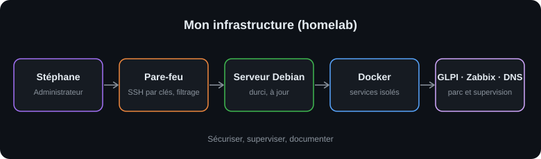

<div align="center">



<br />

<a href="https://www.linkedin.com/in/stéphane-metche-117852318"></a>
<a href="https://mr-metche.com"></a>


<br /><br />



</div>

---

## Profil

```bash
$ whoami
stephane   # reconversion vers l'administration systèmes et réseaux

$ cat objectif.txt
Titre professionnel AIS : Administrateur d'Infrastructures Sécurisées

$ cat labs.txt
Linux (Debian) · Windows Server · Zabbix · SSH · pare-feu
```

Je monte des labs, je les documente ici, et je n'affiche que ce que j'ai réellement fait.

---

## Stack et compétences

| | |
|---|---|
| **Pratiqué en lab** |      |
| **Automatisation** |     |
| **Étudié en formation** |   |

---

## Projets

<!--PROJECTS:START-->
| Projet | Description | Domaine | Mis à jour |
|---|---|---|---|
| [**zabbix-monitoring-lab**](https://github.com/stephanemetche/zabbix-monitoring-lab) | Supervision d'un Debian et d'un Windows Server avec Zabbix 7.0 : agents, test d'alerte, résolution | Supervision · Linux · Windows | 17/10/2026 |
| [**linux-server-setup**](https://github.com/stephanemetche/linux-server-setup) | Installation et sécurisation d'un serveur Linux : utilisateurs, SSH, pare-feu | Systèmes · Sécurité | |
| [**Linux-fundamentals**](https://github.com/stephanemetche/Linux-fundamentals) | Fondamentaux de Linux et parcours d'apprentissage | Systèmes | |
| [**bash-loops-training**](https://github.com/stephanemetche/bash-loops-training) | Automatisation de tâches avec les boucles Bash | Automatisation | |
| [**the-cuve**](https://github.com/stephanemetche/the-cuve) | MVP SaaS d'aide à la décision pour les viticulteurs | Développement | |
<!--PROJECTS:END-->

*Ce tableau est régénéré automatiquement par GitHub Actions à partir de `projects.json`.*

---

## Contact

<div align="center">

Un échange sur l'administration systèmes, les réseaux ou la cybersécurité ?

<a href="https://www.linkedin.com/in/stéphane-metche-117852318"></a>

</div>
